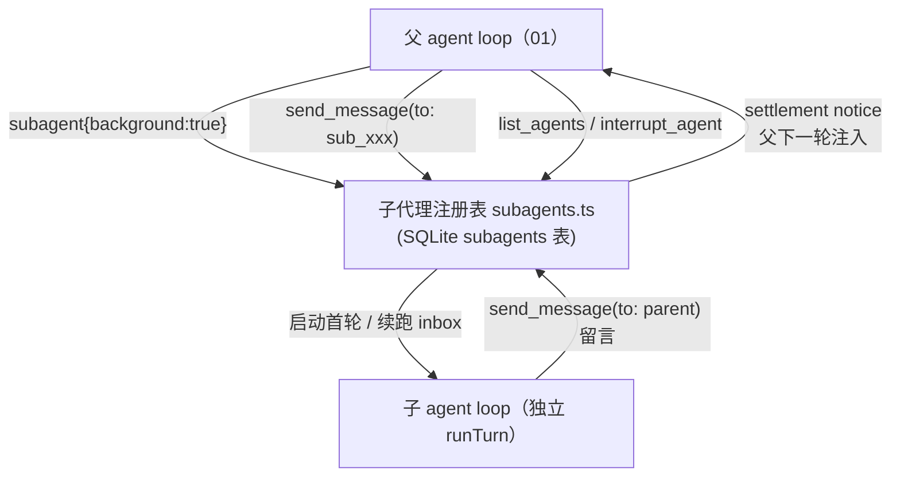

# 代码走读 09：子 Agent 体系与父子通信 —— 把活拆出去，还能聊回来

> 一个 agent 干不完所有事：要并行调研、要独立审查、要后台盯一个长任务。那就派生**子 agent**。
> 但"派出去"只是第一步——难点在**通信**：子看不到父的上下文怎么办？子跑完结果怎么回来？
> 能不能在子跑的中途跟它说话？
>
> 这篇讲 Nova 的三级父子通信：**spawn / fork（一次性）+ background（后台常驻，可持续对话）**。
> 核心文件：`server/toolRegistry.ts`（subagent 工具 + 控制工具族）、`server/subagents.ts`（子代理注册表）、
> `server/agentLoop.ts`（结算通知注入）。
> 建议顺序：01 → 这篇（依赖 01 的 runTurn 与注册表理解）。

## 0. 术语速查

| 名词 | 大白话 |
|---|---|
| **子 agent（subagent）** | 主 agent 派出去独立干活的"小 agent"，有自己的完整 loop 和会话 |
| **spawn（全新子任务）** | 子从零开始，`task` 必须自包含——子不知道父聊过什么 |
| **fork（继承式子任务）** | 子**继承父已完成的历史 + 当前用户消息**（一次性快照）——"继续刚才讨论的方案"就靠它 |
| **background / 后台子代理** | `subagent` 加 `background: true`：立即返回 durable id，子后台独立跑，跑完/失败自动通知父 |
| **durable id** | 稳定的子代理编号（`sub_xxx`），跨请求有效——之后靠它 `send_message` / `list_agents` / `interrupt_agent` |
| **inbox（消息队列）** | 父发给子的消息先进队列：子空闲就启动新轮处理；子正忙就排队，当前轮结束后再处理 |
| **泵（pump）** | 把子代理跑成一连串"轮"的后台循环：首轮 = task，之后 = inbox 队首；队列空就 idle 收工 |
| **settlement notice（结算通知）** | 子代理完成/失败/留言时，自动在父**下一轮请求**里注入一条"子代理 sub_xxx 有新动态：…" |
| **谱系（parentId）** | 记录"谁是谁的子"。`send_message` 只允许直系通信（父↔直接子），防止越级乱聊 |
| **一次性握手 vs 持续对话** | 一次性：跑完拿一个结果（spawn/fork）。持续对话：后台常驻，随时发消息（background） |

---

## 1. 它在架构里的位置



要点：**父和子是两个独立的 loop**（各有自己的会话、自己一轮轮的模型请求）。中间人是 `subagents.ts` 的注册表——它管"有哪些子、什么状态、父发的消息排队、子完成的通知怎么送回父"。这样父子互相解耦：子崩溃不影响父，父中断也会连带停子（见 §6）。

---

## 2. 一次性子任务：spawn / fork（跑完拿一个结果）

`subagent` 工具的**默认模式**（`background: false`），适合"派出去独立查一下、等结果回来"。

### spawn：从零开始

子会话 `messages: []`——子完全不知道父聊过什么，所以 `task` 必须自包含（把目标、约束、交付格式一次说清）。

### fork：继承父的历史

`fork: true` 时子会话 `messages: structuredClone(父 session.messages)`——继承父已完成历史 + 当前用户消息。

**两个关键设计**：

1. **一次性快照**：fork 在创建时拷贝一次，父之后的进展不会再带给子。这是设计决定（不是缺陷）——避免父每轮都往子塞历史导致成本爆炸。子要"最新情报"，靠 `send_message` 单独要。
2. **深拷贝（structuredClone）**：不是引用传递。子跑起来后可能会做上下文压缩（compact 会改写 `messages`），如果共享引用，子一压缩就把父的历史也改了——**父被子的内部操作污染**。深拷贝隔离父子。

### 结构化结果回传

一次性子任务完成后，父模型拿到的不是裸文本，而是一段结构化协议：

```
[子任务结果]（步骤数 3，Token 输入 1200 / 输出 800）
<子任务的最终结论>
```

子没产出最终结论时，返回**部分完成** + 完整部分产出（所有 assistant 输出截 2000 字）；失败时返回**失败原因 + 部分产出**。父模型据此判断："值不值 / 要不要修正 task 重试 / 能不能基于部分进展继续"——而不是拿到一句 `Error: xxx` 瞎猜。

---

## 3. 后台子代理：background（持续对话）

`subagent` 加 `background: true`——**立即返回**，不阻塞父当前轮：

```
[子代理已启动] id: sub_xxx（后台运行中）。
可随时用 send_message（to: sub_xxx）与它对话，用 list_agents 查看状态，
用 interrupt_agent 中断；它空闲/完成时会自动通知你。
```

### 注册表 + 独立存储

`subagents.ts` 的注册表字段：`id / parentId / agentId / task / model / status / inbox / messages / notice`。

**为什么用独立 SQLite 表 `subagents`，而不是塞进 `sessions` 表？**
- 子代理是"后台常驻的独立实体"，有自己的生命周期（running/idle）和父子关系
- 塞进 `sessions` 表会**污染前端会话列表**——用户会看到一堆 `sub_xxx` 会话
- 子代理的持久历史（`messages`）存在自己的 `messages` 列，resume 时重新组装成 Session 喂 `runTurn`

### 泵（pump）：后台怎么"一直跑"

`toolRegistry.ts` 里的 `pumpSubagent` 把子代理跑成一串"轮"：

```
首轮：content = task
  ↓ 调 runSubagent(子会话, 子agent, content) —— 完整一轮
一轮结束：appendNotice（结算通知）→ 读最新注册表
  ├─ inbox 空 → 置 idle，收工
  └─ inbox 非空 → 取队首，跑下一轮
```

一轮跑完 **inbox 空就 idle**，不是无限转——后台子代理"干完手头活就歇着等消息"。

---

## 4. 控制工具族：send_message / list_agents / interrupt_agent

这三个是父子通信的"基础设施"，**始终装配**（不参与 Agent 勾选过滤）——因为 agent 是否需要它们取决于"运行期有没有后台子代理"，静态勾选表达不了。

### send_message：父↔子双向

- **父 → 子**（`to: sub_xxx`）：消息进子 inbox。子空闲 → 立即启动新轮处理；子运行中 → 排队（当前轮结束自动处理）。
- **子 → 父**（`to: parent`）：仅子代理会话里可用（注册表按 `session.id = sub_xxx` 反查认亲）。留言写进 `notice`，随结算通知送达父。

**设计取舍（对比 DSH）**：DeepSeek 的 DSH 用 AI SDK 的 steer 在子**运行中途**注入消息（打断当前步）。Nova 没有这个能力，退而求其次用**队列语义**——运行中来的消息排队，下一轮才处理。代价是"不能中途纠偏"，收益是"实现简单、不打断子的执行"。面试被问"能不能中途插话"时，答清楚这个取舍就够。

### list_agents：我在后台还有谁在干活

列出**当前会话派生**的全部后台子代理：durable id、运行状态（运行中/空闲）、任务、待处理消息数。父模型靠它盘点"我还有几个后台任务"。

### interrupt_agent：中断但别销毁

`interrupt_agent(id)` 中断子代理**当前轮**（触发 abort），但**保留注册表、历史与 inbox**——之后还能 `send_message` 让它继续。和"销毁"是两回事：中断是暂停，销毁是删除。

---

## 5. 结算通知（settlement notice）：父怎么"知道"子干完了

后台子代理干完，父不会自动被"喊醒"（父是请求-响应模型，没有常驻进程）。解法：**父下一轮组装 history 时，自动把未消费的通知注入**。

`agentLoop.ts` 里（`attemptModel` 组装 history 时）：

```ts
const notices = pendingNotices(session.id)   // 查：作为父，有没有未消费的通知
for (const n of notices) {
  history.push({ role: 'user', content: `[系统通知] 你的后台子代理有新动态：\n${n.text}` })
  consumeNotice(n.id)                        // 注入后消费，防溢出重试重复注入
}
```

**为什么不做"子一结束就实时推给父"？** 因为父会话可能正在被另一个 turn 写入——并发写同一个 session 对象有竞态（子写一半，父 turn 结束 saveSession 覆盖）。注入到"父的下一轮请求"是零竞态的：父自己的 turn 组装时读注册表，读多少消费多少。

代价：父**必须再发一轮**才能看到通知（不能躺着等）。这就是 `send_message` / `list_agents` 存在的意义——父可以主动问"你干完了吗"。

---

## 6. 隔离与中断传播

- **隔离**：子代理是独立 `runTurn`、独立会话，子崩溃/报错只影响它自己，父照常——这是天然成立的（父和子根本不共享执行上下文，只共享一个注册表做协调）。
- **中断传播**：父 turn 被用户 Stop 时，`abortRun` 会连带中断所有活动子任务（`activeSubruns`）。后台子的泵也把自己注册进父的 `activeSubruns`——所以**父一停，后台子一起停**，不会留下"父关了子还在后台烧 token"的幽灵（01 练习 4 的延伸）。

---

## 7. 设计取舍（面试追问链）

1. **为什么不用 AI SDK 的 steer 中途注入消息？** 队列语义的取舍：简单、不打断子执行；代价是不能中途纠偏。→ §4
2. **为什么子代理独立建表，不塞 sessions 表？** 不污染会话列表；子有自己的生命周期字段。→ §3
3. **fork 为什么深拷贝？** 防子压缩/改写污染父历史。→ §2
4. **settlement notice 为什么注入父的下一轮，而不是实时推送？** 避免并发写父会话的竞态。→ §5
5. **为什么控制工具族始终装配？** 是否"需要"取决于运行期状态，静态勾选表达不了。→ §4

---

## 8. 验收标准（读完你能）

1. 说出 spawn / fork / background 三模式的区别与各自适用场景（各举一例）。
2. 画出 `send_message` 的完整数据流：父发消息 → 子 idle/running 两种分支 → 子处理 → 结算通知回父。
3. 解释为什么 settlement notice 注入"父的下一轮"而不是实时推送；说出这么做的代价。
4. 说出 `interrupt_agent` 与"删除子代理"的区别；说出父中断时后台子为什么也会一起停。
