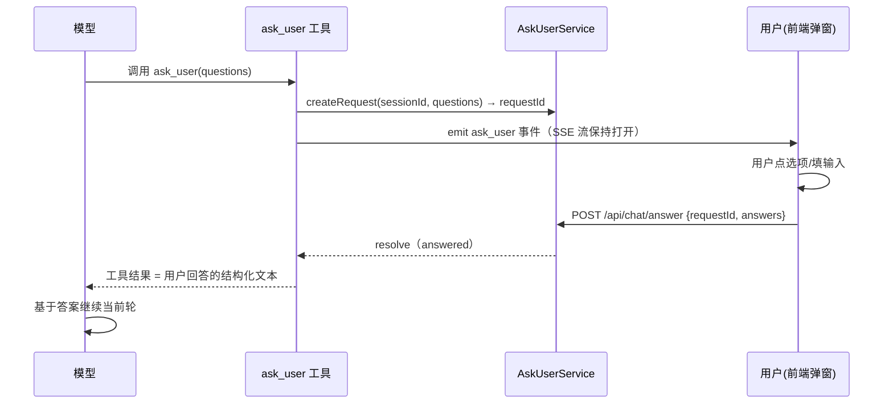

# 代码走读 10：Human-in-the-loop —— agent 停下来，问用户

> 上一课（09）解决了"把活拆给子 agent"；这一课解决反过来的问题：**agent 卡在需要人拍板的点**。
> 是瞎猜继续，还是停下来问？主流框架的答案是后者——这叫 **human-in-the-loop（人机协作环）**。
>
> 这篇讲 Nova 的 `ask_user` 工具：调用后**暂停当前轮**，把问题推给前端弹窗，用户回答后继续。
> 核心文件：`server/askUser.ts`（等待/回答/取消的纯状态机）、`server/toolRegistry.ts`（ask_user 工具）、
> `server/routes/chat.ts`（回答路由）、`src/components/AskUserModal.tsx`（弹窗）。
> 建议顺序：01 → 09 → 这篇（依赖 01 的 runtime 注入与 09 的 capability seam 思路）。

## 0. 术语速查

| 名词 | 大白话 |
|---|---|
| **human-in-the-loop** | "人在回路"：agent 在执行链路的某个点暂停，请人做决定/给信息，拿到答案再继续 |
| **ask_user** | Nova 的提问工具：可一次问 1-5 个问题（每个带选项/多选/自由输入），当前轮暂停等待 |
| **挂起提问（pending）** | 已发出、还没收到回答的提问请求（存在 AskUserService 的注册表里） |
| **requestId** | 每次提问的唯一 id（`ask_xxx`）。前端提交回答时带回它，服务按它找到该次提问 |
| **结算（settle）** | 提问被回答（answered）或取消（cancelled）后，从注册表移除并 resolve 等待中的工具 |
| **capability seam** | 工具不直接依赖服务实现，而是通过 runtime 注入的服务对象调用——可替换、可测试 |
| **RAII 释放** | "借来的资源用完/异常时自动归还"。这里指：提问无论被回答/取消/中断，注册表必清理，不留泄漏 |

---

## 1. 它在架构里的位置



关键点：**SSE 流不关**——工具 `await wait` 时，模型的当前轮"悬停"，用户回答后答案作为**普通工具结果**喂回模型，模型接着跑。这就是"暂停一轮"的机制，和 DSH 的 userQuestions 完全同构（"pauses until a UI provider returns a human answer, then feeds that answer back into the agent loop as an ordinary tool result"）。

---

## 2. 为什么"停下来问"是核心能力（对齐开源）

| 框架 | 策略 |
|---|---|
| **DSH** | `ask_user_question`：可一次多问、结构化答案（id 回显 + selected[] + custom）、**无限等待 + abort 取消**（不设超时） |
| **Codex** | ElicitationService：暂停工具结果投递，**并发计数**（全部答完才恢复），RAII 自动释放 |
| **Claude Code** | 权限模式 + 终端确认 prompt（Y/n / always allow），拒绝后 agent 换路 |

三家的共识：**等待不设强制超时（超时会破坏"人介入"的语义），但取消/中断必须干净**。Nova 对齐了这个共识，并把"权限审批"留给未来（见 §7 的 intent 扩展位）。

---

## 3. 服务层：`server/askUser.ts`（纯状态机，谁都不认识）

```ts
export class AskUserService {
  createRequest(sessionId, questions): { requestId, wait: Promise<Outcome> }
  answer(requestId, sessionId, answers): boolean    // 校验后 settle
  cancel(requestId, sessionId, reason): boolean     // 用户主动取消
  cancelAllForSession(sessionId, reason): number    // 会话中断/结束清理
  peek(sessionId): { requestId, questions } | null  // 前端/测试查询
}
```

**为什么它"什么都不知道"是设计**（不是偷懒）：
- 不 import HTTP / SSE / agentLoop / toolRegistry——**不 emit 事件、不调模型、不碰会话**。
  谁调用、谁广播，由调用方决定（工具 execute 负责 emit，answer 路由负责接 HTTP）。
- 结果就是：这个文件能**独立单测**（`askUser.test.ts` 五条用例，零 mock）；工具与路由互不 import，改一边不炸另一边。

**取消/中断 = 清理纪律（对齐 Codex RAII）**：
- `answer` / `cancel` / `cancelAllForSession` 都是 `settle()`：从 `pending` 和 `bySession` 两个索引移除，再 `resolve`。
- 会话中断时 `agentLoop.abortRun` 调 `cancelAllForSession`——**挂起提问不留幽灵**，和 09 课的"父中断连带停子"是同一套哲学（发散式清理）。

---

## 4. 工具层：`server/toolRegistry.ts` 的 askUserDef

### capability seam（对齐 DSH 的 ctx.userQuestions）

ask_user 工具**不 import 服务实现**，而是通过 `ToolRuntime.askUserService`（agentLoop 构建 runtime 时注入）调用：

```ts
export interface ToolRuntime {
  ...
  askUserService: AskUserService   // human-in-the-loop 注册表（见 askUser.ts）
}
```

这样测试能给 runtime 注入**独立**的 AskUserService 实例（`toolRegistry.test.ts` 的 ask_user 用例就是这么干的），不污染进程级单例。

### 参数结构（对齐 DSH）

```
questions: [{ id, question, header?, options?: [{ label, description? }], multi_select? }]  // 1-5 个
```

- `id` 稳定，答案中回显（`[q1] 选择了：…`）——模型拿到结构化文本，不会把两个问题搞混
- `options` 带 `description`（一句话讲清取舍），推荐项放第一并标 `(Recommended)`（DSH 同款约定）
- `multi_select` 多选；单选问题选了多个会被服务校验拒绝

### 两个关键行为

**① 子代理禁止直接问**（对齐 DSH `DELEGATED_CALLER`）：

```ts
if (rt.depth > 0) return { content: 'Error: 子代理不能直接询问用户——请把未决问题带回父代理…', isError: true }
```

为什么？子代理在后台跑（09 课），它"问用户"会打扰父正在做的事、且子没有直接面对用户的入口。正确姿势：子把未决问题写进结果，父拿到后在**自己的轮**里问。

**② 取消不是 error**：

```ts
const outcome = await wait
if (outcome.status === 'cancelled') {
  return { content: '用户取消了提问（原因：…）。不要继续等待；基于已有信息给出结论或替代建议…' }
}
```

用户点取消 ≠ 中断当前轮——turn 继续跑，模型收到"用户取消了"，**换一条不需要答案的路推进**。这是 human-in-the-loop 的关键语义：人不是必须回答，人可以拒绝，agent 要优雅地继续。

---

## 5. 事件与路由：SSE 怎么"悬停"

1. 工具 `emit({ type: 'ask_user', sessionId, requestId, questions })` → 前端 `store.ts` 的 `handleEvent` 存进 `pendingAsk` → 弹窗出现。
2. **SSE 连接保持打开**（turn 没结束），前端 `streamEvents` 继续收后面的 `text`/`tool_call_*`/`done`。
3. 用户提交 → `POST /api/chat/answer { sessionId, requestId, answers, cancelled? }` → 路由调 `askUserService.answer/cancel` → `resolve` → 工具返回 → 模型继续 → 后续事件照常推。

**为什么不用"又一个 SSE 事件"回传答案？** 因为 SSE 是**服务端→前端单向**的；答案是从前端回服务端的，得走普通 HTTP POST。事件管"推送问题"，HTTP 管"回收答案"——各司其职，别混。

---

## 6. 前端弹窗：`AskUserModal.tsx`

- 挂在 `App.tsx`（全局），读 `store.pendingAsk` 渲染。
- 多问题逐条渲染：header + 问题文本 + 选项按钮（单选/多选，选中高亮）+ 自由输入框（custom）。
- 底部：**提交**（构建 `answers: [{id, selected, custom}]` 调 `answerAsk`）与 **取消提问**（`cancelAsk`）。
- 只展示**当前会话**的挂起提问；后台会话（已切走）的 ask 不弹窗，等中断/取消由后端结算（第一版限制，见 §7）。

`store.ts` 的三处联动：
- `case 'ask_user'` → 设 `pendingAsk`
- `answerAsk` / `cancelAsk` → 成功后清 `pendingAsk`
- `done` / `vibe_done` / `error` → 兜底清 `pendingAsk`（回合结束弹窗必关）

---

## 7. 设计取舍（面试追问链）

1. **为什么无限等待，不设超时？** 对齐 DSH/Codex："人介入"需要时间，强超时会打断用户思考。代价是用户一直不答就一直挂——所以必须有**取消按钮**和**中断清理**两条退路。未来若想加"等待进度条"（Codex 有 pause timeout progress），是在弹窗显示已等待时长，而不是强制断开。
2. **为什么取消不是 error？** error 会让模型认为"出错了"，可能反复重试；取消是"人拒绝提供答案"，模型应该**换路推进**（给建议/基于现状结论）。语义不同，返回文本也不同。
3. **为什么子代理不能问？** 子代理是后台任务，没有面对用户的入口，且会打断父正在做的事。未决问题应随结果带回父，由父在父的轮里问。
4. **为什么服务层不 emit 事件？** 解耦：服务是纯状态机（可单测），广播职责属于调用方。想加"问题被前端拒绝/页面关闭"的通知，改工具 execute，不碰服务。
5. **intent（权限审批）扩展位？** DSH 的 question 还支持 `intent: { kind: 'approve', approve: label, detail }`——用于"批准某个危险操作"。Nova 第一版刻意不做（审批属于权限系统，与澄清/决策是两回事）；未来接入时可复用同一注册表，只扩参数与校验。

---

## 8. 验收标准（读完你能）

1. 画出 ask_user 的完整时序：模型 → 工具 → 服务 → SSE → 弹窗 → POST → resolve → 模型继续。
2. 说出"取消不是 error"与"中断即清理"两条纪律，以及它们分别对齐了哪家开源实现。
3. 解释为什么 ask_user 用 capability seam（runtime 注入）而不是直接 import 服务；说出测试如何受益。
4. 说出子代理为什么不能直接问用户，以及正确替代姿势。
5. 说出第一版的已知限制（后台会话不弹窗）与可扩展方向（等待进度、intent 审批）。
